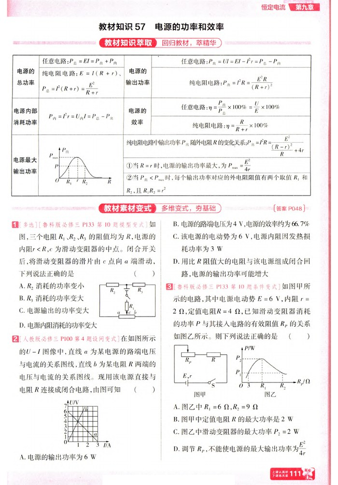
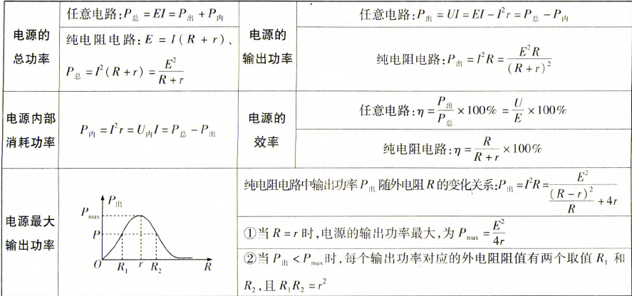
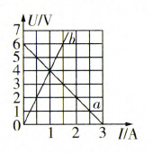

# MiniCPM-OCR 能力评估 — API、实测与补位判断

> **目的**：评估 ModelBest 平台的 MiniCPM-OCR 1.0 + MiniCPM-OCR Jev 能否为本项目
> （MinerU 解析结果的后处理层）补充解析、质检与置信分流能力。
>
> **状态**：探针（probe），**不是验收**。样本 = 1 页同步解析 + 13 页整本异步 + 4 个 Jev 评分点。
> 按项目规矩，上量必须 100+ 题/整本逐题验证；本文只回答「值不值得进入下一轮验证」。
>
> **日期**：2026-11-02。分支：`feature/oxr`。
>
> **证据**：`docs/evidence/2026-11-02-minicpm-ocr-*`（裁图 + 原始 JSON）。
> 原始运行时产物同时保留在 `data/archive/2026-11-02/minicpm-probe/`，但 `data/` 被 git 忽略，
> 以 `docs/evidence/` 为准。
>
> **密钥**：从 `~/.zshrc` 的 `MiniCPM_API_KEY` 读取，只在进程内使用，未打印、未落盘。
> 文档里的环境变量名 `MODELBEST_API_KEY` 是官方示例名；本机用 `MiniCPM_API_KEY` 实测通过。
>
> **维护约定**：本文是 2026-11-02 的探针快照。后续复测/接入请**追加新章节**，不改写本文
> 旧数字；与项目「历史决策只增不改写」的口径一致。

---

## 0. 结论摘要（先看这 5 条）

1. **这不是一个 OCR，是两个模型。** `MiniCPM-OCR-1.0`（1.3B）负责「读」：整页 → Markdown +
   表格 HTML + 公式 LaTeX + 带 bbox 的块；`MiniCPM-OCR-Jev`（2B）负责「判」：拿原图和一份
   OCR 结果打分，或从多份候选里选优。**Jev 不生成、不纠正文本**，把它当解析模型传
   `document-parse` 是调错端点。
2. **读模型值得当第三/第四独立源。** 单页同步 2.72s；本页的表格 HTML、公式 LaTeX 和两栏
   阅读顺序都明显优于 MinerU 同页表格；整本 13 页异步也能跑通（13/13 Success）。
3. **读模型不能信图。** 13 页里 7 个 `chart` 块全部被写成数字表，数值与图不一致；图像块
   `skipped_no_vlm` 内容为空。图必须用 bbox 从原图裁，`chart` 文本一律不可信。
4. **Jev 最值钱，但默认阈值不能直接用。** 公式 0.657 vs 篡改 0.0012、短标题 0.997 vs 0.091，
   默认 0.5 可用；长正文 0.119、带图表格 0.204，默认 0.5 会把正确项也毙掉。它适合做
   **相对排序/选优/人工复核路由**，绝对门必须按类别和长度重新标定。
5. **吞吐结论：1 本/日够用，100 本/日不够。** 整本异步约 23s/页、每用户/项目最多 2 个活动
   任务；按 150 页/本估算，100 本/日串行约 96 小时。要上量得本地 vLLM 并行，或客户端对同步
   接口做并发（受 RPM/TPM 约束）。

**一句话判断**：它能补「第二意见 + 质检层」，不能替代 MinerU，更不能当金标准。

---

## 1. 两个模型与适用边界

| 模型 | 参数 | 角色 | 输入 | 输出 | 不做什么 |
|---|---:|---|---|---|---|
| `MiniCPM-OCR-1.0` | 1.3B | 文档解析 | 单图（同步）或图片/PDF（异步） | 整页 Markdown（表格 HTML、公式 LaTeX）、`ocr.blocks[]`（order/label/bbox/regions/content/status）、`ocr.rotation` | 不描述图像内容；`chart` 可能编表 |
| `MiniCPM-OCR-Jev` | 2B | 质量评估/选优 | 原图 + OCR 文本（或候选列表） | `prob_yes`、`best_index`、`verdict(s)` | 不生成、不改写、不补漏 |

### 1.1 术语

- **同步**：`POST /v1/document-parse`，单张图片，请求内等待结果。
- **异步**：`POST /v1/document-parse/jobs`，图片或 PDF，返回 job，轮询 `GET .../jobs/{id}`。
- **块（block）**：页面上的一个内容单元，带 `label`（text/table/image/chart/...）、`bbox`、
  `order`、`content`、`status`。
- **bbox**：`[x1,y1,x2,y2]`，左上角为原点；若 `rotation.applied=true`，坐标基于旋转后的页面。
- **score / score_best**：`score` 给一条 OCR 文本打 `prob_yes`；`score_best` 给同一原图的多条
  候选打分并返回 `best_index`。
- **verdict**：`scored` 才表示模型真的打了分；`precheck_reject`/`render_error`/`forward_error`
  等是占位状态，分数 0 或 -1 不代表「模型认为差」。
- **ternary 输入**：Jev 的固定输入形式 = 原图 + OCR 文本 + 文本渲染图。长块/表格的渲染排版
  与原件差异大，是绝对分偏低的重要嫌疑（本文标为推断，需标定验证）。

---

## 2. API 调用方式

### 2.1 鉴权与端点

| 事项 | 值 |
|---|---|
| Base URL | `https://api.modelbest.cn` |
| 鉴权 | `Authorization: Bearer <API Key>` |
| 同步解析 | `POST /v1/document-parse` |
| 异步解析 | `POST /v1/document-parse/jobs`；`GET /v1/document-parse/jobs/{id}`；`DELETE /v1/document-parse/jobs/{id}` |
| 文件上传 | `POST /v1/files` → `file_id`；`POST /v1/files/{id}/links` → 临时 URL |
| Jev | `POST /v1/chat/completions`（OpenAI 兼容） |
| 模型列表 | `GET /v1/models` |

`GET /v1/models` 实测返回可用模型包含：

- `MiniCPM-OCR-1.0`（1.3B，`document_parse` 能力）
- `MiniCPM-OCR-Jev`（2B，`vision`/`input_image` 能力）

### 2.2 同步单图

请求（JSON）：

```bash
curl --fail-with-body https://api.modelbest.cn/v1/document-parse \
  -H "Authorization: Bearer $MiniCPM_API_KEY" \
  -H 'Content-Type: application/json' \
  --data '{
    "model": "MiniCPM-OCR-1.0",
    "image": "data:image/png;base64,...",
    "upright": true,
    "recognize_seal": true
  }'
```

- `image` 可为 Base64 或 data URI；`file_id` 必须属于当前用户/项目；`url` 必须是真实公网
  HTTP(S)，禁止私网、回环、链路本地地址及 URL 用户名密码。
- `image` / `file_id` / `url` 三选一；同步只接受单张图片，不接受 PDF，不支持流式。
- `upright` 默认 `true`（自适应旋转）；`recognize_seal` 默认 `true`；`false` 时保留印章布局，
  `content` 为空、`status` 为 `skipped_seal`。

响应关键字段：

| 字段 | 说明 |
|---|---|
| `choices[0].message.content` | 按阅读顺序拼接的整页 Markdown；表格为 HTML，公式为 LaTeX |
| `metadata.page_index` | 从 0 起的页码 |
| `ocr.image_width / image_height` | 结果坐标对应的页面宽高（像素） |
| `ocr.blocks[].order / label / content` | 阅读顺序、类型、块内容 |
| `ocr.blocks[].bbox / regions` | 主框及全部区域，`[x1,y1,x2,y2]`，左上角原点 |
| `ocr.blocks[].status` | `ok` / `failed` / `skipped_no_vlm` / `skipped_seal` |
| `ocr.rotation` | `enabled/applied/total_angle/skipped_reason`；角度逆时针为正 |
| `usage` | `prompt_tokens` / `completion_tokens` / `total_tokens` |
| `result_status` / `issues` | 同步响应的整体状态与告警 |

注意：`header`、`footer`、`number`、`footnote`、`aside_text` 不进入整页 Markdown，但仍在
`blocks` 中。整页 `complete` 不代表所有块成功，必须逐块检查 `status`。

### 2.3 异步整本

```bash
# 1) 提交（multipart 直接传原件）
JOB=$(curl -sS --fail-with-body https://api.modelbest.cn/v1/document-parse/jobs \
  -H "Authorization: Bearer $MiniCPM_API_KEY" \
  -F 'file=@book.pdf' \
  -F 'model=MiniCPM-OCR-1.0' \
  -F 'upright=true' \
  -F 'recognize_seal=true' | jq -r .id)

# 2) 轮询（建议 1–2s）
curl -sS --fail-with-body "https://api.modelbest.cn/v1/document-parse/jobs/$JOB" \
  -H "Authorization: Bearer $MiniCPM_API_KEY"
```

- 提交返回 `202`，查询返回 `200`，**都不代表识别成功**，必须看 `status`：
  `Running` / `Success` / `Failed` / `Cancelled`。
- 结果字段：`pages_done` / `pages_total` / `pages[]` / `markdown` / `error`。
  `pages[]` 按 `metadata.page_index` 升序；`markdown` 是全文合并结果。
- 任务和输出保留 24 小时；每个用户/项目最多 2 个活动任务；建议 1–2 秒轮询，
  客户端 15 分钟超时（超时不会自动取消任务）。
- 未完成或失败时可能保留已完成页，**不能当完整结果**。
- `DELETE` 取消不删除原件，不撤销已完成推理；已完成任务返回原终态。
- 幂等：`Idempotency-Key` 仅支持 JSON `file_id`/`url`，最多 128 字符；multipart 带它会
  返回 400。需要幂等时先上传，再复用同一个 `file_id` 和键提交。

### 2.4 Jev：评分 / 选优 / 批量

请求（`score` 单块）：

```bash
curl --fail-with-body https://api.modelbest.cn/v1/chat/completions \
  -H "Authorization: Bearer $MiniCPM_API_KEY" \
  -H 'Content-Type: application/json' \
  --data '{
    "model": "MiniCPM-OCR-Jev",
    "messages": [{"role": "user", "content": [
      {"type": "image_url", "image_url": {"url": "data:image/png;base64,..."}},
      {"type": "text", "text": "<OCR 文本>"}
    ]}],
    "minicpm_ocr_jev": {
      "mode": "score",
      "category": "formula",
      "threshold": 0.5
    },
    "stream": false
  }'
```

请求（`score_best` 多候选）：

```json
{
  "model": "MiniCPM-OCR-Jev",
  "messages": [{"role": "user", "content": [
    {"type": "image_url", "image_url": {"url": "data:image/png;base64,..."}},
    {"type": "text", "text": "候选 A\n\n候选 B"}
  ]}],
  "minicpm_ocr_jev": {
    "mode": "score_best",
    "category": "table",
    "candidates": ["候选 A", "候选 B"]
  },
  "stream": false
}
```

`minicpm_ocr_jev` 关键字段：

| 字段 | 说明 |
|---|---|
| `mode` | `score` / `score_best` / `score_best_batch` |
| `category` | `text` / `formula` / `table`；批量时在 `item` 内指定 |
| `input_form` | 固定 `ternary`：原图 + 文本 + 文本渲染图 |
| `threshold` | 仅 `score` 使用；默认 0.5；`prob_yes >= threshold` 为质量达标 |
| `candidates` | `score_best` 的候选文本，顺序与响应一致 |
| `items` | 批量条目；非空；单次最多 64 个评分项 |
| `render_image` / `render_images` | 高级选项；自定义渲染图，服务端不再做预检和自动渲染 |

响应：

- `choices[0].message.content` 是 **JSON 字符串**，建议从这里解析；顶层 `usage` 是计费用量。
- `score`：`results[].case_id/category/verdict/prob_yes/prob_no/detail` + `summary`。
- `score_best`：`best_index` / `best_text` / `scores[]` / `verdicts[]` / `stage_sec` / `batch_size`。
- `best_text` **原样返回被选中的输入文本**，不是重新识别或纠正后的文本。
- 若全部候选都未完成评分，可能返回 `best_index=0` + 第一条候选作为回退；使用前必须检查
  `verdicts[best_index]`。
- `summary.pass_rate` = 成功评分比例（与质量阈值无关）；`summary.throughput_rate` = 质量达标
  比例，不是每秒吞吐量。

内容类别与输入格式：

| category | 输入格式 |
|---|---|
| `text` | 正文或 Markdown；正文中的公式保留正确 LaTeX |
| `formula` | 公式 LaTeX；JSON 字符串中的反斜杠需要转义 |
| `table` | HTML 表格；OTSL 或 Markdown 表格需先转换为 HTML |

### 2.5 限制与坑

| 事项 | 规则 |
|---|---|
| 输入上限 | 原件 64 MiB；单图 24 MiB；同步 JSON 32 MiB；PDF ≤500 页、服务端 144 DPI、单页 ≤4000 万像素、单边 ≤8192 px |
| 格式 | 解析：PDF / PNG / JPEG / GIF / BMP / WEBP；Jev：PNG / JPEG |
| 同步/异步 | 同步只收单图，PDF 必须异步；异步不支持流式 |
| Jev 批量 | 单次 ≤64 个评分项；`messages` 仍需包含相同图片和文本；批量缺少这些内容可能 400 `moderation_invalid_input` |
| Jev 状态 | 只有 `scored` 的分数有效；`precheck_reject`/`render_error`/`forward_error` 的 0 或 -1 是占位值 |
| 块状态 | `ok` / `failed` / `skipped_no_vlm` / `skipped_seal`；整页完成 ≠ 所有块成功 |
| 旋转 | `rotation.applied=true` 时 bbox 基于旋转后的页面；画框前按 `total_angle` 摆正原图 |
| 幂等 | `Idempotency-Key` 仅 JSON `file_id`/`url`；multipart 带它返回 400 |
| 任务路径 | 文档解析任务不能从 KIE 路径查询，反之亦然 |

### 2.6 错误处理

| HTTP | 处理 |
|---|---|
| `400 / 413` | 检查输入来源、字段、格式与请求大小；不要原样重试错误参数 |
| `401 / 403` | 检查 API Key、账号和模型权限 |
| `402` | 额度不足；同步调用检查计费状态，异步失败读取任务 `error` |
| `404` | 检查当前用户/项目下的文件或任务，以及对应任务路径 |
| `409` | 幂等键已用于不同输入或参数 |
| `422` | Jev 类别、字段类型、必填项、候选列表或渲染图数量有问题 |
| `429` | 减少活动任务，按 `Retry-After` 或指数退避重试 |
| `5xx` | 稍后重试，保留 `X-Request-Id`；不要记录签名链接和凭据 |

---

## 3. 实测

### 3.1 样本与方法

| 项 | 内容 |
|---|---|
| 原卷 | 《物理·教材基础练 电路》第 5 页；整本 13 页 PDF |
| 页图 | `data/out/物理_教材基础练 电路/pages/page-05.png`（1000×1431） |
| 同步 | 第 5 页 PNG，data URI，`MiniCPM-OCR-1.0`，`upright=true`，`recognize_seal=true` |
| 异步 | `origin.pdf`（13 页）multipart 提交，轮询到终态 |
| Jev | 标题裁图、公式裁图、表格裁图、长正文裁图；每块给正确/篡改候选，公式/表格另加 MinerU 候选 |
| 对照 | MinerU 同页 `layout.json`、OXR 同页 `layout.oxr.json`、MinerU `full.md` |

裁图坐标：

- 表格块：`[32,161,919,577]`（来自 MiniCPM 同步结果 `blocks[3]`）
- 长正文块：`[31,651,463,821]`（`blocks[6]`）
- U-I 图：`[175,1165,345,1335]`（含外扩）
- 公式：`[480,285,919,345]`（效率公式单元格）

### 3.2 解析质量

#### 3.2.1 速度与块状态

| 指标 | 同步单页 | 整本异步 |
|---|---:|---:|
| 耗时 | **2.72s** | **303.4s / 13 页 ≈ 23.3s/页** |
| 页数 | 1 | 13/13 `Success` |
| 块数 | 21 | 340 |
| `ok` | 17 | 273 |
| `skipped_no_vlm` | 4（图像） | 67（图像/页脚图） |
| 非图像块失败 | 0 | 0 |
| 字符数 | 2,168 | 21,155（合并 Markdown） |
| tokens | 6,260 | 每页 10,758 / 19,613 等（逐页 `usage`，顶层无汇总） |

同步页 `result_status=complete`、`issues=[]`；异步 13 页逐页 `result_status=complete`、无 `issues`。

#### 3.2.2 表格与公式

同一页，MiniCPM 的表格是一个完整 `<table>`，保留 `rowspan/colspan`，公式转 LaTeX；
MinerU 的 `layout.json` 把表格拆成多行，公式下标出现乱码（`P_{↓}`、`P_{Ψ}` 等），
`<eq>` 片段与文字顺序错位；OXR 的 `layout.oxr.json` 也是按行拆开的表格文本，不是完整表结构。

本页关键公式（`E²/(4r)`、`R₁R₂=r²`、`η=U/E×100%`）在 MiniCPM 输出中均正确。





#### 3.2.3 阅读顺序

本页是两栏试卷。MiniCPM 的内容顺序为：第 1 题 → 第 2 题 → 第 2 题跨栏选项 A–D →
第 3 题 → 第 3 题选项。第 2 题的 A 在左栏、B–D 在右栏，输出顺序正确。

这是**单页**结论，不能外推为「分栏已解决」；需要用含侧栏、跨栏、答案页的样本专项验证。

#### 3.2.4 图表幻觉（重要）

第 5 页的 U-I 曲线图被输出成一张数值表：

```
I/A   U/V
0.5   6.5
1.0   4.5
1.5   6.0
2.0   5.0
3.0   1.0
```

这些数值与图中两条直线不一致，属于编造/误读。整本 13 页里 **7 个 `chart` 块全部变成了
数字表**，还出现 `U/N`、`x/AA`、`X_axis_label` 等异常轴标签。



**操作规则**：`label=chart` 的 `content` 一律不能进入题目文本；图要用 `bbox` 从原图裁，
按图片资产处理，必要时再走独立的图像理解/人工核对。

#### 3.2.5 同步 vs 异步

同一页（p5）同步与异步内容的相似度 **0.909**，不是字节级一致：

- 异步去掉了下标里的 `\text{}`（如 `P_{\text{出}}` → `P_{出}`）；
- 异步把图片占位改成 `&lt;img /&gt;`；
- 图表那块的表不同（同步/异步都不是可信内容）。

**操作规则**：审计要固定路径（同步或异步）和版本；不要把某一次输出当成可复现事实。

### 3.3 Jev 评分

| 测试块 | 正确候选 | 篡改候选 | 其他候选 | 解释 |
|---|---:|---:|---:|---|
| 标题（短正文） | **0.997** | 0.091 | — | 默认 0.5 可用 |
| 公式 | **0.657** | 0.0012 | MinerU 0.00027 | 默认 0.5 可用；跨模型识别强 |
| 表格 | 0.204 | 0.0015 | MinerU `precheck_reject` | 排序可用；绝对门不可用 |
| 长正文（约 170 字） | 0.119 | ≈0 | — | 排序可用；绝对门不可用；长块要拆短 |

补充实测：

- 用 `score` 模式复核：长正文 **0.119**、表格 **0.212**，`summary.throughput_rate` 都是 **0.0**
  （阈值 0.5），确认默认 0.5 会把正确项判不合格。
- Jev 单次 1.1–2.9 秒；tokens 340–3092（取决于块长度和候选数）；`completion_tokens=0`。
- 表格测试中 MinerU 原样 HTML 得到 `precheck_reject`，不是 0 分；说明输入格式没进模型。
  若要走 Jev 比较 MinerU 表格，必须先把 `<eq>` 等标签规范成合规 HTML。
- 公式测试中 MinerU 候选（去 `<eq>` 后）得到 0.00027，说明跨模型识别乱码有效。

**为什么长块/表格绝对分低（推断）**：Jev 的 `input_form=ternary` 会把 OCR 文本重新渲染成
图片，再和原图比对。短标题/公式几乎一一对应；长段落/表格的渲染排版与原件差异大，分数被
拉低。官方没有这样解释，需用本项目样本标定验证。

### 3.4 未验证 / 不能下结论

- **价格、RPM/TPM**：官方文档只说明「以控制台模型列表/配置为准」，没有公开具体数值；
  本次只记录 token 用量，不知道单价。
- **500 页 PDF**：只测了 13 页；500 页上限没有实测。
- **本地部署**：没有跑 vLLM/SGLang/llama.cpp/Ollama；12GB 显存、ARM 1.2s/次是公开资料口径。
- **印章识别**：没有印章样本；`recognize_seal` 未验证。
- **Jev 泛化**：只有 4 个评分点、1 页样本；不能当作全库准确率。
- **图表处理**：只测了《电路》一本；其他书的图表幻觉率未知。
- **同步/异步非确定性**：只比较了 1 页；差异是否稳定、是否影响题号/公式，未系统测。
- **100+ 题/整本逐题验收**：未做；本文只是探针。

---

## 4. 相对其他 OCR 服务的特点

### 4.1 对照表

| 维度 | MiniCPM-OCR 1.0 | MinerU（现用主解析） | PaddleOCR-VL（现用校验源） | 夸克 Word（现用第二意见） |
|---|---|---|---|---|
| 角色 | 端到端页面解析（1.3B） | 全书面解析流水线 | 版面 + 文本校验 | 独立文本源 |
| 速度 | 同步 **2.7s/页**；异步 **23s/页** | 未做同页同口径测 | 75–90s/页（项目记忆口径） | 不是逐页 OCR |
| 表格 | 单块 HTML + LaTeX，本页最整 | 同页表格拆行、下标乱码 | 行级文本，结构弱 | 无/弱 |
| 公式 | LaTeX，本页关键公式正确 | 有，但表格内公式乱码 | 有 LaTeX | 电路 18 条起草 0 条含公式 |
| 分栏/顺序 | 本页两栏正确（含跨栏选项） | 项目内有分栏误判史 | 有版面块 | 不涉及 |
| 图/图表 | 图块跳过；chart 会编表（7/7） | 图单独存 | 有图块 | 不涉及 |
| 定位 | bbox/regions/order | bbox/layout | bbox | 无 |
| 可自部署 | Apache 2.0；vLLM/SGLang/llama.cpp/Ollama；Jev 约 12GB 显存 | 可本地 | 可本地 | 否（第三方） |
| 最适合 | 第二解析源、表格/公式、快速单页 | 主解析 | 独立校验 | 文本第二意见 |

> 表格/公式/分栏是**这一页**的实测，不是全量结论；Paddle/MinerU 的速度和准确率没有做同页
> 同口径的全量对比。

### 4.2 读模型的特点

**强项**

- **表格结构**：完整 HTML + `rowspan/colspan` + LaTeX；本页明显优于 MinerU 的拆行/乱码。
- **公式**：关键公式正确；对公式密集型试卷有价值。
- **阅读顺序**：本页两栏正确，含跨栏选项。
- **速度**：同步 2.7s/页；比 PaddleOCR-VL 的 75–90s/页快一个数量级。
- **结构化定位**：`order/label/bbox/regions` 齐全，能直接裁图、画框、做块级对齐。

**弱项**

- **图不描述**：`skipped_no_vlm`，内容为空；只有 bbox。
- **chart 会编表**：13 页 7/7 中招；必须黑名单。
- **同步/异步不一致**：同一页 0.909 相似度；不能当字节级可复现。
- **不是全量版面重建**：没有 MinerU 那种全书面 layout 流水线；多页/跨页结构要自己拼。

### 4.3 判模型的特点

**强项**

- **跨模型**：候选可以来自 MinerU、Paddle、Word、MiniCPM；不绑定解析供应商。
- **公式/短文本区分极强**：0.657 vs 0.0012、0.997 vs 0.091。
- **N-best 选优**：`score_best` 直接返回 `best_index/best_text`，适合多源融合。
- **机器优先**：适合接「置信分流/人工复核路由」，符合项目「大规模验证必须机器做」的方向。
- **不改写**：只打分/选优，天然符合「检测不改写」红线；选中的候选带来源和分数即可审计。

**弱项**

- **不是金标准**：分数不是 CER/WER；默认阈值不跨域。
- **不会补漏**：所有候选都错时救不了；`best_text` 只是原样候选。
- **长块/表格绝对分低**：0.119/0.204；要么拆短块，要么按类标定，要么自定义渲染图。
- **输入格式敏感**：表格要 HTML；MinerU 原样 `<eq>`/`` 会 `precheck_reject`。
- **单页探针**：泛化未验证。

### 4.4 与本项目已知短板的映射

| 项目短板 | MiniCPM 1.0 能否补 | Jev 能否补 | 证据/限制 |
|---|---|---|---|
| 整行漏识别 / 题号漏 | 部分：本页题号与阅读顺序完整；粗计数 32 vs MinerU 25，但不可当覆盖率 | 间接：给候选打分，低分转人工；不能发现所有候选都漏的题 | 需 100+ 题逐题对齐 |
| 分栏误判 | 本页两栏顺序正确；仅 1 页 | 不直接 | 需侧栏/跨栏/答案页专项 |
| 表格结构 / 公式乱码 | 强：本页表格 HTML 与公式 LaTeX 明显更整 | 强：公式跨模型区分 0.657 vs 0.00027；表格排序有效 | 表格绝对分低；输入要规范 |
| 假题 / 错误合并 | 间接：更完整的题号/顺序可作第二证据 | 间接：候选评分可标记异常；不能理解题号语义 | 仍需结构审计（§99 等） |
| 图注/图内文字 | 弱：图块跳过，chart 编表 | 不适用 | 图走裁图 + 独立 OCR/人工 |
| 置信分流 / 人工复核 | 不直接 | **强**：score/score_best 可直接做路由 | 必须按类标定阈值 |
| 速度/上量 | 强：同步 2.7s/页；异步 23s/页 | 强：1–3s/块 | 云端异步 2 个活动任务 |

### 4.5 能补什么 / 补不了什么

**能补**

1. **第二解析源**：在表格/公式密集页做独立对照；用 bbox 裁图，不依赖它的 chart 文本。
2. **质检/选优层**：Jev 给 MinerU、Paddle、Word、MiniCPM 的候选打分/选优，接置信分流；
   也可在流水线改动后做回归检测（固定样本的分数分布）。
3. **本地/离线**：Apache 2.0，权重可本地部署，数据不出机器；1.3B + 2B 合计约 3.3B；
   Jev 单独约 12GB 显存；适合敏感题库和上量。

**补不了**

- 不能当金标准；Jev 分数不是 CER/WER，默认阈值不跨域。
- 不会改字/补漏；候选里没有正确答案时无解。
- 图/图表不能信它的文本；必须单独裁图。
- 云端异步 1 本/日够用，100 本/日不够。
- 本文只是 1 页 + 13 页探针，不是 100+ 题验收。

---

## 5. 建议

### 5.1 P0：先标定 Jev（最高优先，最低集成成本）

**为什么先做**：Jev 不依赖换解析源，能直接接在现有 MinerU 产物上；它的价值/风险都集中在
阈值是否可分。先用它，能最快回答「置信分流能不能落地」。

**做法**

1. 从现有金标准/答案册取 100+ 个块，覆盖 `text` / `formula` / `table`，并覆盖：
   短块、长块、含图表格、正确/错误候选、全部候选都错的样本。
2. 每块准备：原图裁图、正确文本、至少一个错误候选（来自 MinerU/Paddle/Word/人工篡改）。
3. 跑 `score` 和 `score_best`，记录 `verdict/prob_yes/best_index`。
4. 按类别和长度分别标定阈值；不要用统一 0.5。
5. 评估指标建议（具体数值由你定）：
   - 在固定人工复核预算（如 10% 块）下，低分块覆盖的错误数 / 总错误数；
   - 高分块的错误率（漏放率）；
   - `score_best` 选中正确候选的比例；
   - `precheck_reject`/`render_error` 的比例（输入规范成本）。

**验收前置**：先证明「低分块里确实集中了错误」，再谈接入。标定 ≠ 验收，另留 held-out 集。

### 5.2 P1：MiniCPM 1.0 当第三解析源（分层抽样）

**做法**

1. 选分层样本：表格页、公式页、两栏页、含侧栏/答案页、图表页各若干。
2. 与 MinerU/Paddle/Word 逐题对齐；指标：
   - 题号覆盖（分母来自原卷/OCR 独立来源，不用 MiniCPM 自己的输出）；
   - 公式/表格正确性（人工/金标准）；
   - 阅读顺序（跨栏、跨页）；
   - 图表块是否被误当文本。
3. `label=chart` 一律排除；图用 bbox 裁。
4. 先做只读对照，不改现有管线；确认收益后再写适配器。

### 5.3 P2：部署与成本

- **云端**：适合实验和 1 本/日；异步 2 个活动任务，23s/页；价格看控制台。
- **本地**：vLLM/SGLang/llama.cpp/Ollama + AWQ/GPTQ/GGUF；Jev 约 12GB 显存；
  适合敏感数据和 100 本/日；先测吞吐/显存，再决定。
- **许可证**：Apache 2.0（权重/代码/文档），商用不需另谈授权；仍需保留许可证声明。

### 5.4 集成草图（只读对照，不改写）

```
原图 ──► MiniCPM-OCR-1.0 ──► Markdown + blocks ──► 第二解析源（只读对照）
  │
  └──► 按 bbox 裁块 ──► Jev ◄── 候选（MinerU / Paddle / Word / MiniCPM）
                           │
                           └──► score / best_index ──► 高置信放行
                                                       低置信转人工
```

红线：

- Jev 只做检测/排序，**不静默替换**；任何选择都记录来源、分数、verdict。
- `chart` 文本不进题目正文；图走图片资产。
- 置信门控的判据不能只看 Jev 分数，仍需结构审计/覆盖率等独立判据。

### 5.5 风险登记

| 风险 | 影响 | 缓解 |
|---|---|---|
| 阈值漂移 | 换书/换题型后误杀或漏放 | 按类别/长度标定；固定样本回归；held-out 验收 |
| 图表幻觉 | 假数字进入题目 | `label=chart` 黑名单；图只裁不读 |
| 同步/异步不一致 | 审计不可复现 | 固定路径/版本；保存原始响应 |
| 输入格式预检失败 | 表格无法评分 | 规范 HTML；监控 `precheck_reject` 比例 |
| 云端吞吐/额度 | 100 本/日不可行 | 本地部署或同步并发；先测 RPM/TPM |
| 供应商依赖 | 服务变更/涨价 | Apache 2.0 本地权重；保留 MinerU/Paddle 多源 |

---

## 6. 复现与证据

### 6.1 证据文件

| 文件 | 内容 |
|---|---|
| [`docs/evidence/2026-11-02-minicpm-ocr-parse-page05.json`](evidence/2026-11-02-minicpm-ocr-parse-page05.json) | 第 5 页同步解析完整响应（含 blocks/usage/issues） |
| [`docs/evidence/2026-11-02-minicpm-ocr-async-circuit.json`](evidence/2026-11-02-minicpm-ocr-async-circuit.json) | 13 页异步任务完整响应（含逐页 blocks/usage） |
| [`docs/evidence/2026-11-02-minicpm-ocr-jev-formula-best.json`](evidence/2026-11-02-minicpm-ocr-jev-formula-best.json) | 公式 `score_best`：正确/篡改/MinerU 三候选 |
| [`docs/evidence/2026-11-02-minicpm-ocr-jev-table-best.json`](evidence/2026-11-02-minicpm-ocr-jev-table-best.json) | 表格 `score_best`：正确/篡改/MinerU 三候选 |
| [`docs/evidence/2026-11-02-minicpm-ocr-jev-title-best.json`](evidence/2026-11-02-minicpm-ocr-jev-title-best.json) | 短标题 `score_best` |
| [`docs/evidence/2026-11-02-minicpm-ocr-jev-text-best.json`](evidence/2026-11-02-minicpm-ocr-jev-text-best.json) | 长正文 `score_best` |
| [`docs/evidence/2026-11-02-minicpm-ocr-jev-text-score.json`](evidence/2026-11-02-minicpm-ocr-jev-text-score.json) | 长正文 `score` 门控复核（0.119 / throughput 0） |
| [`docs/evidence/2026-11-02-minicpm-ocr-jev-table-score.json`](evidence/2026-11-02-minicpm-ocr-jev-table-score.json) | 表格 `score` 门控复核（0.212 / throughput 0） |
| [`docs/evidence/2026-11-02-minicpm-ocr-page05.jpg`](evidence/2026-11-02-minicpm-ocr-page05.jpg) | 第 5 页缩略图 |
| [`docs/evidence/2026-11-02-minicpm-ocr-table-crop.png`](evidence/2026-11-02-minicpm-ocr-table-crop.png) | 表格裁图 |
| [`docs/evidence/2026-11-02-minicpm-ocr-chart-crop.png`](evidence/2026-11-02-minicpm-ocr-chart-crop.png) | U-I 图裁图 |

### 6.2 复现步骤

1. 读取 key：`MiniCPM_API_KEY`（本机在 `~/.zshrc`，不要写入仓库）。
2. 同步解析：按 §2.2 的 curl，把 `image` 换成第 5 页 data URI；预期 2–3 秒，
   `blocks` 约 21 个，`chart` 会被写成表。
3. 异步整本：按 §2.3 提交 `origin.pdf`，轮询到 `Success`；预期 13/13，约 5 分钟，
   逐页 `usage` 可见，顶层无汇总。
4. Jev：按 §3.1 裁图，按 §2.4 构造候选；预期分数见 §3.3。
5. 对照：MinerU `data/out/物理_教材基础练 电路-MinerU/layout.json`；
   OXR `data/out/物理_教材基础练 电路/layout.oxr.json`。

### 6.3 环境

- 日期：2026-11-02
- 分支：`feature/oxr`
- 页图：`data/out/物理_教材基础练 电路/pages/page-05.png`（1000×1431）
- PDF：`data/out/物理_教材基础练 电路/origin.pdf`（13 页）
- 模型：`MiniCPM-OCR-1.0`、`MiniCPM-OCR-Jev`

---

## 7. 给外部评审的问题

> 这节是给别的模型/评审人看的，不需要先读完全文；问题都对应上面的实测数字。

1. **Jev 的绝对分在长正文/表格上低于 0.5**（0.119/0.204），但排序仍能分开正确/错误。
   本文判断应改为「短块评分 + 分类/长度阈值 + 相对选优」，而不是整页一刀切。
   这个判断是否成立？有没有更合适的标定/校准方法（按块长度分层、自定义 `render_image`、
   只用 `score_best` 排序而非绝对门）？
2. **MiniCPM 1.0 当第三解析源**：优先只用于表格/公式页，还是做全页对照？考虑适配成本
   （`ocr.blocks[]` → 现有 layout 结构）和收益，哪条更划算？有没有必要把它的 Markdown
   直接当主文本源？
3. **图表块被写成数字表**（13 页 7/7）：本文建议 `label=chart` 黑名单 + bbox 裁图。
   是否还有更可靠的图表检测/隔离方案？是否应该把 chart 一律降级为图片资产？
4. **吞吐结论**：云端异步约 23s/页、每用户/项目 2 个活动任务；本文判断 1 本/日可行、
   100 本/日不可行。这个结论是否漏算了客户端同步并发、批量提交或本地 vLLM 并行？
   12GB 显存 / 1.3B+2B 的本地吞吐假设是否合理？
5. **Jev 是否适合当置信门控的主信号**：它的分数不是 CER/WER，且长块会漂移。本文建议
   它与结构审计、覆盖率等独立判据并用。这个组合是否足够？有没有更可靠的“机器可判”
   替代信号（例如多源文本一致度）？

---

## 8. 来源

- [ModelBest 文档解析 API](https://platform.modelbest.cn/console/docs/api/document-parse)
- [ModelBest OCR 正确性决策 API](https://platform.modelbest.cn/console/docs/api/ocr-jev)
- [ModelBest 文档解析模型](https://platform.modelbest.cn/console/docs/models/document-parse)
- [ModelBest OCR 质量评估模型](https://platform.modelbest.cn/console/docs/models/ocr-jev)
- [GitHub: OpenBMB/MiniCPM-OCR](https://github.com/OpenBMB/MiniCPM-OCR)
- [Hugging Face: MiniCPM-OCR-1.0](https://huggingface.co/openbmb/MiniCPM-OCR-1.0)
- [BAAI 社区供稿：面壁智能开源 MiniCPM-OCR 系列模型](https://hub.baai.ac.cn/view/59205)
- [新浪财经：MiniCPM-OCR 系列发布](https://cj.sina.cn/articles/view/1654203637/629924f5020017w6i)
- [FlagOS 适配：Jev 12GB 显存 / ARM 单次约 1.2 秒](https://segmentfault.com/a/1190000048378586)
- [GitCode：MiniCPM-OCR-1.0（Apache 2.0）](https://gitcode.com/OpenBMB/MiniCPM-OCR-1.0)

> 厂商/媒体口径（未独立复现）：MiniCPM-OCR 1.0 在 Real5-OmniDocBench 93.68、
> OCRBench v2 54.7；Jev 0.936 AUROC、跨模型接入现有 OCR 系统。

---

## 9. P0/P1 复测结果（2026-11-02，追加）

> 详细报告：[`docs/evidence/2026-11-02-minicpm-p0p1.md`](evidence/2026-11-02-minicpm-p0p1.md)。
> 本节只记结论，不重复方法；旧数字不改写。

### 9.1 P0（Jev 标定）

- 193 个候选（159 文本 / 23 公式 / 11 表格），独立 OCR 回读校验裁图后保留 **153 个**；
  40 个剔除（36 个文本裁图与文本对不上，4 个《磁场》表格不可靠）。
- 150 个有有效分数；`score_best` 的 **best@correct = 150/150（100%）**。
- **默认 0.5 不能全类通用**：
  - 短文本：推荐 **0.02–0.05**（0.02 时正确放行 94.85%、错误放行 1.03%、误复核 5.15%）；
  - 公式：推荐 **0.01–0.02**（0.02 时正确放行 95.24%、错误放行 0%、误复核 4.76%）；
  - 长文本/表格：**绝对门不可用**，只能拆短或相对选优。
- 逐书差异明显：《磁场》correct 均值 0.129 vs《电路》0.756；不能全局一个阈值。
- 残留风险：短文本有 1 个相邻字换位错误得分 0.4845，0.02 绝对门会放过；
  高风控场景要用「相对选优 + margin」，不能只看单候选绝对分。

### 9.2 P1（MiniCPM 1.0 第三解析源）

- 8 页分层样本：**题号覆盖 36/36（100%）**、**0 额外题号、0 逆序**；
  occurrence 级 40/41（答案册 p1 重复 #5 有一次未识别成行首）。
- 基线题干/选项的 4-gram 召回：**均值 0.893 / 中位 0.909 / 最低 0.55**（41 题，0 题低于 0.5）。
- 表格块更整：MinerU 把《磁场》p0 整表拆成 6 个行级表，MiniCPM 输出 1 个完整表；
  《电路》p4 MinerU 表拆成行文本，MiniCPM 输出 1 个表块。
- 图表仍会编表：《电路》p4 唯一 `chart` 块又写成 `<table>`；与首轮 13 页 7/7 一致。
- 速度 1.5–2.7s/页；无 `failed` 块；图像块 `skipped_no_vlm` 3–9 个/页。

### 9.3 更新后的判断

- **Jev 的相对选优**已经可以进入下一轮真实验收；绝对门按类别/书标定，
  长文本/表格不用绝对门。
- **MiniCPM 1.0** 适合作第三解析源，优先题号/顺序/表格块；`chart` 一律排除。
- **前置条件**：裁图对齐必须先用独立 OCR 校验；《磁场》文本保留率只有 34%，
  不做校验会把坐标问题误判成模型能力问题。
- 下一轮：held-out 100+ 块 + 真实 OCR 错误复测阈值；P1 扩到 20–30 页并做表格/公式逐条核对。

---

## 10. 第二轮：真实错误 / 扩页 / 只读原型（2026-11-02 追加）

> 详细报告：[`docs/evidence/2026-11-02-minicpm-p0p1.md`](evidence/2026-11-02-minicpm-p0p1.md)
> §7–§10。旧数字不改写；本节只记第二轮结论。

### 10.1 P0-2：真实错误验收

- 来源：`corrections/*.json` 201 条（138 条 verified）→ 169 个可映射候选 →
  tesseract 两轮对齐后 132 条 → 131 条成功评分（1 条内容策略拦截）。
- **block 级真实错误（insert+replace，n=123）**：AUC **0.942**、best@correct **94.3%**；
  - insert n=110：AUC 0.938、best 94.5%；
  - replace n=13：AUC 0.988、best 92.3%。
- **真实阈值（block 级）**：0.02 时正确放行 **80.49%**、错误放行 **1.63%**、误复核 **19.51%**；
  0.01 时 83.74% / 2.44% / 16.26%。
- 与合成集对比：合成短文本 0.02 时 94.85% / 1.03% / 5.15%；
  **合成集明显偏乐观**，真实错误正确放行低约 14 个百分点、误复核高约 14 个百分点。
- **replace_text（缺前缀/半行修补）**：前缀在同一视觉行的 4 条 best 4/4；
  前缀在上一视觉行的 4 条单行裁图不成立，不能算模型失败；需改“逻辑块”裁图。
- 7 条失败（123 条里 5.7%）：公式片段/裁图单元、行/段单元、以及 O→0 的真实难点
  （正确 0.0276 vs 错误 0.5173）。

### 10.2 P1-2：22 页扩页对照

- 22 页、106 个唯一题号：**覆盖 106/106（100%）**、0 额外、0 真逆序；
  occurrence 111/112（答案册 p1 重复 #5 一次未识别成行首）。
- tesseract 整页 OCR 独立交叉：**没有发现任何 MiniCPM 漏掉的基线题号（tess-only=0）**；
  但 tesseract 召回低，只能作单向证据。
- 4-gram 召回：均值 **0.896** / 中位 0.897 / 最低 0.26；2 题低于 0.5，均在答案册
  （疑似续页/合并，不是确定错误）。
- 表格：7 页有表；机械能 p1/p3 单元格 **18/18、20/20 完全一致**；
  其余 5 页 MinerU 把表拆成行文本（table block=0），MiniCPM 输出 14–18 格完整表。
- 公式：273/381（71.7%）粗匹配（归一化相似度≥0.7），**不是准确率**；真正的公式质量看
  P0 的 21 条人工对照。
- chart：1/1 仍编表（电路 p4）；与首轮 13 页 7/7 一致。
- 速度 1.2–3.19s/页；0 个 `failed`；112 个 `skipped_no_vlm` 图像块。

### 10.3 P2：只读原型

- 电路 p4：7 个 MiniCPM/MinerU 候选块，Jev `score_best` → 5 个 prefer_minicpm、
  2 个 review、0 个 auto_pass；4,469 tokens。
- 2 个 review 是文本几乎相同（分数 ~0.996、margin ~1e-5）→ **候选一样时不要硬选**，
  margin 规则有效。
- 裁图来自 MiniCPM bbox，存在裁图源偏置；P2 只证明“只读路由可接”，不是“MiniCPM 更准”。
- 适配器仍后置，未改生产线。

### 10.4 更新后的判断

- **Jev 相对选优是主用法**：真实 block 级 best 94.3%；不要再拿合成集的 100% 当预期。
- **绝对门按真实数据重定**：block 级 0.01–0.02；0.02 误复核约 1/5，必须加 margin/人工。
- **评测单元必须是逻辑块**：`replace_text` 的缺前缀在上一视觉行，单行裁图不成立。
- **MiniCPM 第三源**：22 页题号 106/106、0 额外、0 真逆序；表格块更整；
  chart 仍必须黑名单。
- **P2 只读路由可先跑**；适配器等验收后再说。
